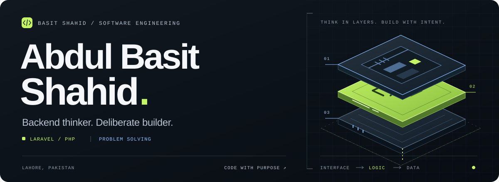
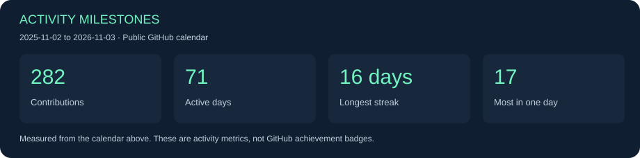
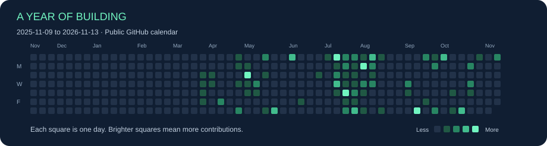

<picture>
  <source media="(prefers-color-scheme: light)" srcset="./assets/portfolio-banner-light.svg" />
  
</picture>

**Software Engineering @ COMSATS University Islamabad, Lahore Campus**

I build for the web, experiment on the desktop, and keep learning how good software fits together.

  

[About](#about) &nbsp; / &nbsp; [Selected work](#selected-work) &nbsp; / &nbsp; [Toolkit](#toolkit) &nbsp; / &nbsp; [Activity](#a-year-in-code) &nbsp; / &nbsp; [Connect](#lets-build-something-useful)

 

## About

I'm **Basit**, a software engineering student in **Lahore, Pakistan**, focused on **Laravel, PHP, and backend development**. I enjoy turning a messy problem into a clear model, then building the interfaces and logic that make it useful.

My projects span publishing, file sharing, and desktop utilities. Alongside them, I practice **C++, Java, and data structures and algorithms** to understand the decisions underneath the code.

**Currently exploring** &nbsp; REST APIs · database design · SOLID principles · trees, graphs & dynamic programming

 

## Selected work

Four projects, four different problems to solve.

<table>
<tr>
<td width="50%" valign="top">

### [Mini Blog ↗](https://github.com/basit-shahid/mini-blog-site)

A Laravel publishing app with authenticated post management, categories, tags, and reading-time estimates.

<strong>LARAVEL · PHP · BLADE · ELOQUENT</strong>

</td>
<td width="50%" valign="top">

### [TurboDM ↗](https://github.com/basit-shahid/Turbodm)

A Windows download manager with parallel transfers, pause/resume, and Chrome and Edge integration.

<strong>ELECTRON · NODE.JS · JAVASCRIPT</strong>

</td>
</tr>
<tr>
<td width="50%" valign="top">

### [Drop ↗](https://github.com/basit-shahid/Drop)

File sharing between desktop and mobile, with local-network transfers and QR-code connections.

<strong>ELECTRON · EXPRESS · REACT NATIVE</strong>

</td>
<td width="50%" valign="top">

### [Portfolio ↗](https://github.com/basit-shahid/Portfolio)

My personal website, bringing together an animated introduction, a project showcase, and my development journey.

<strong>ASTRO · TAILWIND CSS · TYPESCRIPT</strong>

</td>
</tr>
</table>

**[All repositories ↗](https://github.com/basit-shahid?tab=repositories)** &nbsp; · &nbsp; [LeetCode](https://leetcode.com/u/jRkCw0AEbH/) &nbsp; · &nbsp; [My Laravel notes](https://github.com/basit-shahid/Laravel-notes)

 

## Toolkit

**Backend & web**

  
  
  
  
  
  

Laravel · PHP · Node.js · JavaScript · HTML · CSS

**Languages & everyday tools**

  
  
  
  
  
  
  

C++ · Java · Git · GitHub · VS Code · IntelliJ IDEA · Postman

  

## A year in code

Small steps, taken consistently. A daily snapshot of my public GitHub contribution calendar.

<picture>
  <source media="(prefers-color-scheme: light)" srcset="./assets/activity-milestones-light.svg" />
  
</picture>

<picture>
  <source media="(prefers-color-scheme: light)" srcset="./assets/contribution-calendar-light.svg" />
  
</picture>

<strong>Watch the contribution trail come alive →</strong>

 

<picture>
  <source media="(prefers-color-scheme: dark)" srcset="https://raw.githubusercontent.com/basit-shahid/basit-shahid/output/github-contribution-grid-snake-dark.svg" />
  
</picture>

Generated daily by <a href="https://github.com/basit-shahid/basit-shahid/actions/workflows/snake.yml">GitHub Actions</a>.

Cards refresh daily and display their measured date range. <a href="https://github.com/basit-shahid?tab=overview">Source calendar ↗</a> · <a href="https://github.com/basit-shahid?tab=achievements">GitHub achievements ↗</a>

  

## Let's build something useful

I'm open to collaborating on thoughtful projects, learning with other developers, and working through interesting problems.

**[Say hello by email ↗](mailto:basitdogar59@gmail.com)** &nbsp; · &nbsp; [LinkedIn](https://www.linkedin.com/in/abdul-basit-shahid-9612a5424/) &nbsp; · &nbsp; [GitHub](https://github.com/basit-shahid)

 

---

<strong>ABDUL BASIT SHAHID</strong> &nbsp; / &nbsp; Lahore, Pakistan &nbsp; / &nbsp; Build with purpose.

Behind this profile

Artwork, contact buttons, and technology icons are stored in this repository. The banner and activity cards follow your light/dark color preference. Banner motion respects reduced-motion preferences.

Activity cards are daily snapshots generated from GitHub's public calendar. A failed refresh preserves the previous images. The snake animation is generated separately on the `output` branch.

See [asset credits](./assets/ATTRIBUTION.md) and [profile maintenance](./docs/PROFILE.md).

