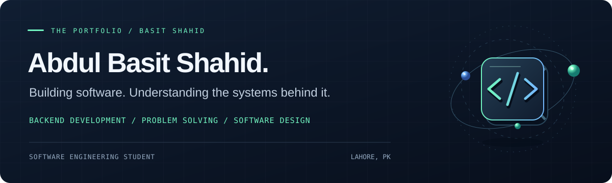
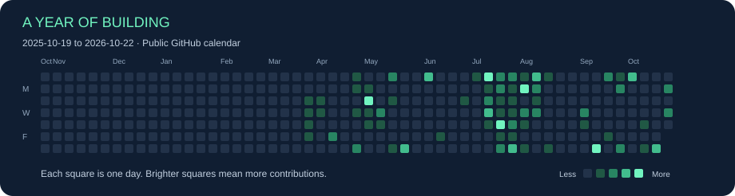
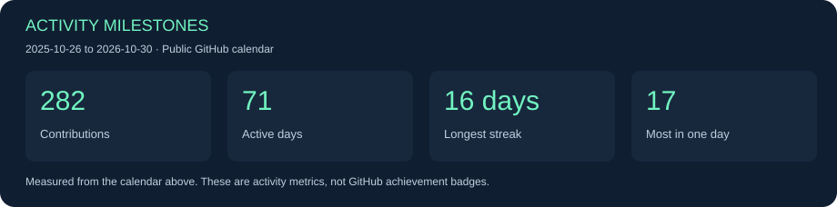

 

**Software Engineering student at COMSATS University Islamabad, Lahore Campus.** 
Building with Laravel and PHP. Thinking in data structures, objects, and systems.

 

  

  

[About](#about) &nbsp; / &nbsp; [Work](#explore-my-work) &nbsp; / &nbsp; [Toolkit](#my-toolkit) &nbsp; / &nbsp; [Currently](#what-im-working-toward) &nbsp; / &nbsp; [Activity](#github-in-motion) &nbsp; / &nbsp; [Contact](#lets-build-something-useful)

 

## About

I'm **Basit**, a software engineering student based in **Lahore, Pakistan**. I enjoy turning a problem into a clear model, writing the logic behind it, and shaping it into something people can use.

My focus is **backend and full-stack development with Laravel and PHP**, alongside a steady practice of **C++, Java, and data structures and algorithms**. I'm interested in how good software fits together: its architecture, its interfaces, and the decisions that make it easier to maintain.

> Build with purpose. Learn without limits.

 

## Explore my work

Two areas guide what I build and study. Browse the repositories to see the code, documentation, and progress behind each.

<table>
<tr>
<td width="50%" valign="top">

### 01 / Web & backend

**From an idea to application logic.**

Laravel and PHP development, with an interest in REST APIs, database-driven applications, and the structure behind a useful web experience.

[Explore PHP repositories →](https://github.com/basit-shahid?tab=repositories&q=&type=source&language=php&sort=updated)

</td>
<td width="50%" valign="top">

### 02 / Algorithms & foundations

**Understand the problem. Design the solution.**

C++ and Java, object-oriented programming, and algorithmic problem solving—the foundations I keep developing alongside application work.

[Explore C++ repositories →](https://github.com/basit-shahid?tab=repositories&q=&type=source&language=c%2B%2B&sort=updated) · [Java →](https://github.com/basit-shahid?tab=repositories&q=&type=source&language=java&sort=updated)

</td>
</tr>
</table>

**[View all repositories ↗](https://github.com/basit-shahid?tab=repositories)** &nbsp; · &nbsp; **[Find me on LeetCode ↗](https://leetcode.com/u/jRkCw0AEbH/)**

 

## My toolkit

| Area | Technologies & focus |
| :--- | :--- |
| **Languages** | C++ · Java · PHP · JavaScript |
| **Web development** | Laravel · HTML · CSS · Node.js |
| **Tools** | Git · GitHub · VS Code · IntelliJ IDEA · Postman |
| **Foundations** | Data structures · Algorithms · Object-oriented programming · Problem solving |

 

 

## What I'm working toward

- **Stronger backend engineering:** exploring REST APIs, database design, and maintainable Laravel applications.
- **Deeper problem solving:** practicing trees, graphs, and dynamic programming.
- **More deliberate software design:** learning architecture, SOLID principles, and design patterns.
- **Complete projects:** connecting implementation, documentation, and deployment.

I'm open to collaborating on projects where I can contribute, learn from others, and solve a useful problem.

 

## GitHub in motion

A live look at my public GitHub activity, languages, and coding consistency.

  

### Contribution landscape

### A little motion, powered by contributions

<picture>
  <source media="(prefers-color-scheme: dark)" srcset="https://raw.githubusercontent.com/basit-shahid/basit-shahid/output/github-contribution-grid-snake-dark.svg" />
  <source media="(prefers-color-scheme: light)" srcset="https://raw.githubusercontent.com/basit-shahid/basit-shahid/output/github-contribution-grid-snake.svg" />
  
</picture>

Generated daily by my <a href="https://github.com/basit-shahid/basit-shahid/actions/workflows/snake.yml">contribution snake workflow</a>. <a href="https://github.com/basit-shahid?tab=overview">View my GitHub contribution calendar ↗</a>

### Milestones & achievements

Measured progress from my public contribution calendar. GitHub achievement badges are available through the profile link below.

[View my GitHub achievements ↗](https://github.com/basit-shahid?tab=achievements)

About these live cards

The contribution calendar and activity milestones are SVGs stored in this repository, refreshed daily by [GitHub Actions](https://github.com/basit-shahid/basit-shahid/actions/workflows/profile-activity.yml) using GitHub’s public calendar. They remain visible if a refresh fails; the date range is printed on each card. No external card service, API key, or package dependency is used for either image.

The other stats, streaks, icons, and view counter use external services and may be cached or temporarily unavailable. The view counter records visits since it was added; it is not a count of unique visitors. Language cards reflect repository code composition. GitHub's own achievements are linked above.

 

## Let's build something useful

Have a project in mind, a problem to work through, or an open-source idea? I'd love to hear about it.

**[Email me](mailto:basitdogar59@gmail.com)** &nbsp; · &nbsp; **[Connect on LinkedIn](https://www.linkedin.com/in/abdul-basit-shahid-9612a5424/)** &nbsp; · &nbsp; **[Follow on GitHub](https://github.com/basit-shahid)**

 

---

<strong>ABDUL BASIT SHAHID</strong> &nbsp; / &nbsp; Lahore, Pakistan &nbsp; / &nbsp; Code with purpose.

